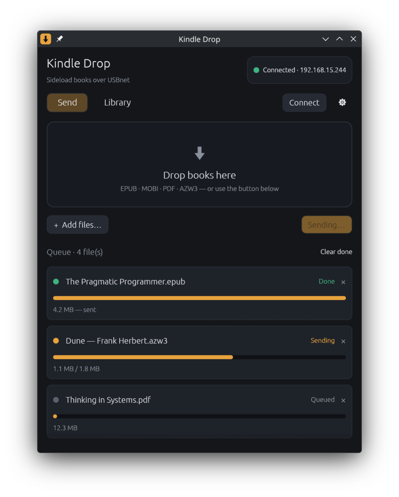
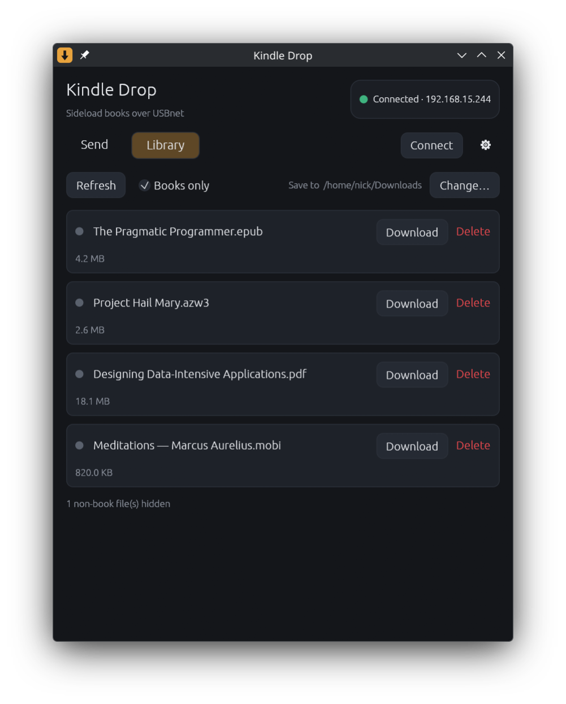

# Kindle Drop

A tiny desktop app for sideloading books onto a **jailbroken Kindle** over USB
networking. Drag books onto the window (or pick them with a file dialog) and they
stream straight to `/mnt/us/documents/`. It also brings up the USB network link
for you and lets you browse, download, and delete books already on the device.

Built in Rust with [egui](https://github.com/emilk/egui) + native SSH
([`ssh2`](https://crates.io/crates/ssh2) / libssh2).

<p align="center">
  
  &nbsp;
  
</p>

## Features

- **Drag & drop** books onto the window, or use **Add files…** (native KDE/portal picker).
- **One-click connect** — auto-detects the Kindle's USB-ethernet interface, brings the
  link up, and assigns your host address via a single graphical polkit prompt.
- **Live per-file progress bars** while sending (uses the legacy SCP protocol, the same
  thing `scp -O` forces, so it works with the Kindle's old dropbear SSH server).
- **Library tab** to manage what's already on the device: **download** books back to your
  PC and **delete** them (with a confirmation; also removes the `.sdr` reading-data sidecar).
  A **Books only** toggle hides non-book files (e.g. the KUAL launcher's `.azw2`).
- **Live connection status** — the pill flips to *Disconnected* when you unplug the cable, and
  **Connect** skips the polkit prompt when the Kindle is already reachable.
- **Restart KOReader** button (and an optional "after sending" auto-trigger) so newly sent books
  show up without touching the device — it stops the running instance and relaunches it the way
  KUAL does (`koreader.sh --kual`), daemonized so it survives the SSH session closing. The command
  is editable in Settings if your setup differs.
- Settings (Kindle IP, host address/CIDR, target dir, download folder) persist to a config file.

## What it replaces

The old manual dance:

```sh
# 1. figure out the interface, then assign an address (needs sudo)
ip link
sudo ip addr add 192.168.15.201/24 dev enp14s0u3

# 2. copy everything in the current dir to the Kindle (empty root password)
scp -O * root@192.168.15.244:/mnt/us/documents/
```

Both steps are now buttons.

## Requirements

- Rust (2021+) and a jailbroken Kindle with **USB networking** enabled.
- System libraries (already present on most Arch installs): `libssh2`, `openssl`, `zlib`.
- For the network-setup step: `polkit` (a running polkit agent, e.g.
  `polkit-kde-authentication-agent-1`), `pkexec`, and `iproute2` (`ip`).
- Assumes the Kindle's `root` account has **no password** (default on jailbroken units).

## Build & run

```sh
cargo build --release
./target/release/kindle-drop
```

## Usage

1. Plug the Kindle in with USB networking on.
2. Click **Connect** — approve the polkit prompt. The pill turns green when the Kindle's
   SSH server is reachable (`192.168.15.244:22`).
3. **Send tab:** drop books (or Add files…) → **Send to Kindle**.
4. **Library tab:** **Refresh** to list books on the device, then **Download** or **Delete**.

Adjust the Kindle IP, your host address/CIDR, the on-device target directory, and the
download folder under **⚙ Settings**. Config is stored at
`~/.config/kindle-drop/config.toml`.

### Headless / demo modes

- **Send from the terminal:** `kindle-drop --send <file>...` connects and uploads without opening
  the GUI (uses the Kindle IP / target dir from your config). Handy for scripts.
- **Demo:** `kindle-drop --demo` seeds the UI with sample data (no Kindle needed) — handy for
  screenshots or poking at the interface. Add `library` to start on the Library tab.

## How it works

- **Interface detection** scans `/sys/class/net/*` for a USB-ethernet gadget
  (`cdc_ether`/`cdc_ncm`/…), which is how the Kindle enumerates.
- **Network bring-up** runs `pkexec sh -c 'ip link set dev <iface> up && ip addr replace
  <cidr> dev <iface>'` — one prompt, and idempotent so it's safe to re-run.
- **Transfers** open one authenticated SSH session per batch (empty-password auth with
  keyboard-interactive fallback) and stream each file with `scp_send` / `scp_recv`.

## Notes

- Deleting a book also removes its `<name>.sdr` sidecar directory.
- If a transfer fails, the row shows the error and the rest of the queue continues; press
  **Send** again to retry the failed items.
